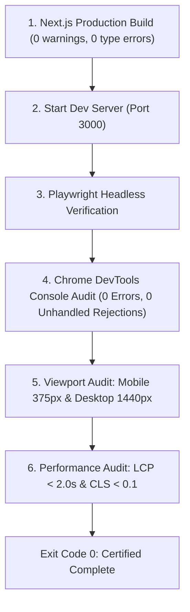

# 4. QA PLAYBOOK & AUDIT VERIFICATION PROTOCOL

**Project:** Ganga Heights by Arohan Realty (Kanpur)  
**Standard:** Zero Fake Passes (Exit Code 0 Verification)  
**Status:** Governance Specification

---

## 1. Automated Verification Gates

---

## 2. Playwright Verification Suite Specification
Tests to be executed in local headless Chromium via Playwright:

### A. Navigation & Structural Smoke
- [ ] Navbar renders wordmark, all 5 section anchor links, and CTA button.
- [ ] Transparent state in Hero converts to solid `#EFEBE4` with `1px border-ink/10` upon scrolling past 80px.
- [ ] Mobile hamburger drawer toggles cleanly without layout thrashing; focus trapped properly; ESC closes.

### B. Hero Search & Listing Filter Interactivity
- [ ] Floating search bar accepts Project Type, BHK, and Budget inputs.
- [ ] Clicking "Explore Residences" smoothly scrolls viewport to Section 05 (`#listings`) and applies the active filter state.

### C. SVG Floor Plans Tabbed Switcher
- [ ] Clicking 2 BHK, 3 BHK, and 4 BHK tabs instantly updates the SVG blueprint drawing and changes the carpet area metrics without layout shift.
- [ ] "Download Architectural Specifications" triggers browser download or spec modal.

### D. Interactive Sticky Amenities Sync
- [ ] Hovering or clicking amenity items (1–6) updates the active image on the right viewport within 200ms.

### E. Financial Engine (EMI Calculator)
- [ ] Sliders / inputs for Property Price, Down Payment %, Interest Rate %, and Loan Tenure (Years) dynamically recalculate Monthly EMI.
- [ ] Verified formula:
  $$EMI = \frac{P \times r \times (1 + r)^n}{(1 + r)^n - 1}$$
- [ ] Zero NaN or infinite values under extreme boundary conditions.

### F. Lead Capture Form (`/api/lead`) & Honeypot
- [ ] Form submission with valid data triggers HTTP 200 and renders elegant confirmation banner.
- [ ] Form submission with populated honeypot (`website_source_verification`) is quietly dropped.
- [ ] Invalid phone numbers (<10 digits) display inline field error message without clearing user input.
- [ ] Direct WhatsApp CTA initiates correct URI with pre-formatted message.

---

## 3. Visual & Aesthetic Critique Checklist (Strict Anti-Slop)
Before human sign-off:
- [ ] **NO generic gradients:** Verified zero purple, indigo, or rainbow gradients.
- [ ] **NO bouncy cards:** Zero spring animations, zero `scale(1.1)`, strictly architectural `cubic-bezier(0.65, 0, 0.35, 1)`.
- [ ] **NO stock photos of smiling models:** Every image container uses high-fidelity architectural renders or tone-matched limestone placeholders with precise photography briefs.
- [ ] **NO forbidden buzzwords:** Zero occurrences of "revolutionize", "elevate", "seamless", "dream home", "luxury living redefined", or "world-class".
- [ ] **Color fidelity:** Background is exact `#EFEBE4`, text is `#14120F`, accent is `#B08D57`, dark sections use `#2F3E36`.
